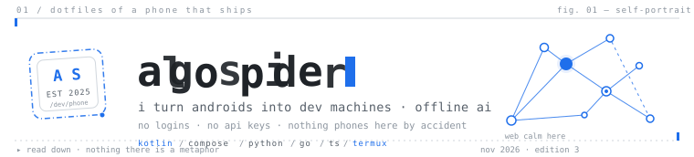
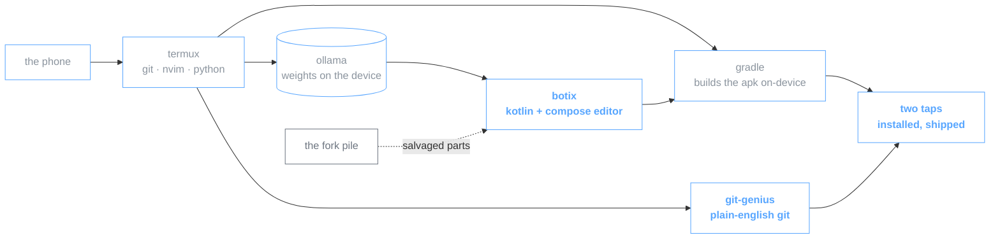

<p align="center">
  <picture>
    <source media="(prefers-color-scheme: dark)" srcset="https://raw.githubusercontent.com/algospider/algospider/main/assets/algospider-banner.svg">
    
  </picture>
</p>

> **whoami** — mohan · programming machines to do what androids were told not to · [@wroughtline](https://github.com/Wroughtline) · account is barely a year old, doesn't matter, **i ship**

<div align="center">
  <sub>
    
    &nbsp;·&nbsp; <a href="https://github.com/algospider/algospider">source of this page¹</a>
  </sub>
</div>

<br>

## 01 · live

| | |
|:--|:--|
| **[botix](https://github.com/algospider/Botix)** | ai code editor that lives on a phone. kotlin + compose, offline brain — cursor-for-android, no subscription |
| **[devpilot](https://github.com/KrishnaVipul14/DevPilot)** | repo health unit with [@KrishnaVipul14](https://github.com/KrishnaVipul14) — scan, map blast radius, fix, verify² |
| **[git-genius](https://github.com/Wroughtline/git-genius)** | git for people whose whole vocabulary is `git add .` — says the command in plain english, then runs it |

## 02 · shipped

| | |
|:--|:--|
| [**8gen**](https://github.com/algospider/8gen) | prompt → playable game. ollama, zero api keys |
| [**CLIGit**](https://github.com/algospider/CLIGit) | the same idea as git-genius, in go — you never had to learn the commands |
| [**quizly**](https://github.com/algospider/QUIZLY) | ai quiz platform — retro ui, provider fallback chain, pdf in → quiz out |
| [**desktop-launcher**](https://github.com/algospider/Desktop-Launcher) | bento tiles + a fake pc with draggable floating windows |
| [**oorja-attendance**](https://github.com/algospider/oorja-attendance) | club event attendance gate — built and shipped the same evening it was needed |

<details open>
<summary><strong>03 · schematic</strong> — how the machine is wired</summary>


</details>

## 04 · the fork pile

<details>
<summary>🩺 <b>what's in the drawer</b></summary>
<br>

acode · soraX · rikkahub · localdesktop · toolneuron · opencode-android · termux-generator · vscode

fork → open → patch → cannibalize → botix. xed-editor taught me release CI, opencode-android taught me what not to rename on fork, vscode was simply too big to not gut.³

<br>
</details>

<br>

<div align="center">
  <picture>
    <source media="(prefers-color-scheme: dark)" srcset="https://img.shields.io/badge/kotlin-7F52FF?style=flat-square&logo=kotlin&logoColor=white&labelColor=0D1117">
    
  </picture>
  <picture>
    <source media="(prefers-color-scheme: dark)" srcset="https://img.shields.io/badge/compose-4285F4?style=flat-square&logo=jetpackcompose&logoColor=white&labelColor=0D1117">
    
  </picture>
  <picture>
    <source media="(prefers-color-scheme: dark)" srcset="https://img.shields.io/badge/python-3776AB?style=flat-square&logo=python&logoColor=white&labelColor=0D1117">
    
  </picture>
  <picture>
    <source media="(prefers-color-scheme: dark)" srcset="https://img.shields.io/badge/go-00ADD8?style=flat-square&logo=go&logoColor=white&labelColor=0D1117">
    
  </picture>
  <picture>
    <source media="(prefers-color-scheme: dark)" srcset="https://img.shields.io/badge/typescript-3178C6?style=flat-square&logo=typescript&logoColor=white&labelColor=0D1117">
    
  </picture>
  <picture>
    <source media="(prefers-color-scheme: dark)" srcset="https://img.shields.io/badge/termux-000000?style=flat-square&logo=linux&logoColor=white&labelColor=0D1117">
    
  </picture>
</div>

## 05 · telemetry

<div align="center">
  <picture>
    <source media="(prefers-color-scheme: dark)" srcset="https://github-readme-stats-one-bice.vercel.app/api?username=algospider&show_icons=true&hide_title=true&hide_border=false&border_color=30363D&bg_color=0D1117&text_color=8B949E&icon_color=58A6FF&title_color=58A6FF&count_private=true&include_all_commits=true&rank_icon=percentile">
    
  </picture>
  <picture>
    <source media="(prefers-color-scheme: dark)" srcset="https://streak-stats.demolab.com?user=algospider&theme=github-dark-blue&hide_border=true&border_radius=8&background=0D1117&stroke=30363D&ring=58A6FF&fire=58A6FF&currStreakNum=58A6FF&sideNums=8B949E&currStreakLabel=8B949E&sideLabels=8B949E&dates=484F58">
    
  </picture>
  <br><br>
  <picture>
    <source media="(prefers-color-scheme: dark)" srcset="https://github-readme-stats-one-bice.vercel.app/api/top-langs/?username=algospider&layout=compact&hide_border=true&bg_color=0D1117&text_color=58A6FF&title_color=58A6FF&langs_count=8&count_private=true&hide_title=true">
    
  </picture>
  <picture>
    <source media="(prefers-color-scheme: dark)" srcset="https://activity-graph.vercel.app/graph?username=algospider&bg_color=0D1117&color=58A6FF&line=58A6FF&point=58A6FF&area=true&area_color=58A6FF&hide_border=true&radius=8">
    
  </picture>
</div>

<p align="center">
  <picture>
    <source media="(prefers-color-scheme: dark)" srcset="https://raw.githubusercontent.com/algospider/algospider/output/github-contribution-grid-snake.svg">
    
  </picture>
</p>

## 06 · trace

```console
$ tail -f ~/algospider.activity
```

<!--RECENT_ACTIVITY:start-->
<!--RECENT_ACTIVITY:end-->

<details>
<summary><b>how this updates</b></summary>

a workflow queries the api every few hours and commits the diff here — the section above is data, not memory. github's idle-cron garbage man disabled it once; pushing a workflow file wakes it back up.

</details>

<br>

<p align="center">
  <a href="https://instagram.com/mohan.hex">
    <picture>
      <source media="(prefers-color-scheme: dark)" srcset="https://img.shields.io/badge/instagram-mohan.hex-E4405F?style=flat-square&logo=instagram&labelColor=0D1117">
      
    </picture>
  </a>
  <a href="https://github.com/Wroughtline">
    <picture>
      <source media="(prefers-color-scheme: dark)" srcset="https://img.shields.io/badge/org-wroughtline-58A6FF?style=flat-square&logo=github&labelColor=0D1117">
      
    </picture>
  </a>
  <a href="https://github.com/algospider/Botix">
    <picture>
      <source media="(prefers-color-scheme: dark)" srcset="https://img.shields.io/badge/botix-star_if_it_compiles-8B949E?style=flat-square&logo=github&labelColor=0D1117">
      
    </picture>
  </a>
</p>

<p align="center"><sub>
  — m. · i answer dms before issues · nov 2026, edition 3
</sub></p>

---

¹ *yes, the profile page source is on github — of course it is. dig through the commit history, watch the thing grow.*

² *devpilot's upstream is [@KrishnaVipul14](https://github.com/KrishnaVipul14)'s — i work the scan-fix-verify lane.*

³ *stars aren't the achievement. shipping is. the pile exists to be eaten.*
